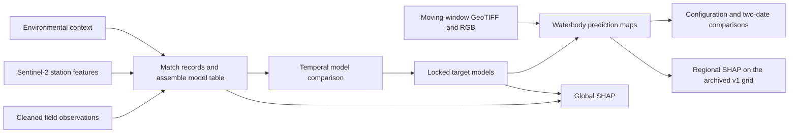

# Sentinel-2 Water Quality Assessment

**Waterbody-scale estimates of turbidity, suspended solids, and an indirect dissolved-oxygen proxy in southern Thailand.** This project compares Sentinel-2 features alone with Sentinel-2 plus environmental context, then maps the selected models and examines what drives their predictions.

[Figure gallery](docs/figures.md) · [Research workflow](docs/workflow.md) · [Team handoff (ภาษาไทย)](docs/handoff-th.md)

*Three representative waterbodies. From left to right: locator, turbidity, suspended solids, and DO proxy. Predictions cover eligible water pixels within the selected scenes.*

## How it works

The model table joins field observations, Sentinel-2 water-pixel features, and contextual variables such as antecedent rainfall, wind, and surrounding land cover. The mapping workflow applies the locked models to 62-band feature rasters, then aligns the outputs with Sentinel-2 RGB imagery for interpretation.

## Selected model results

| Target | Locked model | S2 only R² | S2 + Context R² |
|---|---|---:|---:|
| Turbidity | LinearSVR | 0.8802 | 0.9012 |
| Suspended solids | Two-stage LogisticRegression + LinearSVR | 0.6497 | 0.7455 |
| DO proxy | CatBoost | 0.0086 | 0.7300 |

Each comparison above uses 33 observations in the historical 2024–2025 evaluation. That period informed configuration selection in the original analysis, so these results should be interpreted as historical comparisons. DO proxy is an indirect estimate. SHAP describes model attribution, and the maps support research screening and field follow-up.

## Continue the work

The team route starts with the cleaned field table and the original precomputed Sentinel-2/context features, GeoTIFFs, and RGB exports. With the restricted Drive handoff archive, a collaborator can run the local checks and continue the analysis without Earth Engine access. The [Thai runbook](docs/handoff-th.md) lists inputs, expected outputs, exact archive layout, and outstanding checks. Original export notebooks document how the Earth Engine files were produced.

The public repository contains selected source code, documentation, and figures. Row-level observations, private Drive links, model bundles, and research rasters are distributed to authorized collaborators through the handoff archive.
