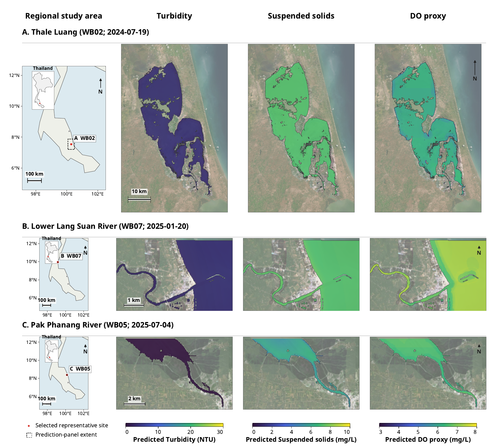
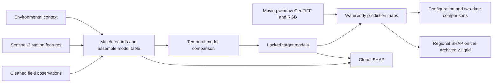
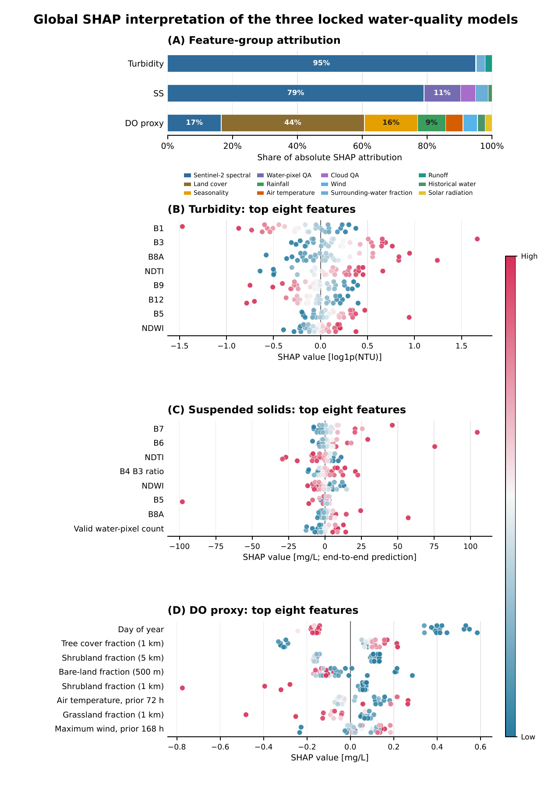

# Sentinel-2 Water Quality Assessment

**Waterbody-scale estimates of turbidity, suspended solids, and an indirect dissolved-oxygen proxy in southern Thailand.** This project compares Sentinel-2 features alone with Sentinel-2 plus environmental context, then maps the selected models and examines what drives their predictions.

[Run in Colab](notebooks/README.md) · [Feature extraction & Drive inputs (ภาษาไทย)](docs/drive-features-th.md) · [Data inventory](docs/data-inventory.md) · [Team handoff (ภาษาไทย)](docs/handoff-th.md) · [Figure gallery](docs/figures.md) · [Research workflow](docs/workflow.md)

**Working with an AI agent?** Ask it to read [AGENTS.md](AGENTS.md) first. The same guide is included at the root of the full v2 team ZIP.

**Ready to reproduce the results?** [Download the full handoff ZIP from Google Drive](https://drive.google.com/drive/folders/1dSAw7W5tQnsAc93H0o5T-V7KA1UJgAHS?usp=sharing).

*Three representative waterbodies. From left to right: locator, turbidity, suspended solids, and DO proxy. Predictions cover eligible water pixels within the selected scenes.*

## How it works

The model table joins field observations, Sentinel-2 water-pixel features, and contextual variables such as antecedent rainfall, wind, and surrounding land cover. The mapping workflow applies the locked models to 62-band feature rasters, then aligns the outputs with Sentinel-2 RGB imagery for interpretation.

## Selected model results

| Target | Locked model | S2 only R² | S2 + Context R² |
|---|---|---:|---:|
| Turbidity | LinearSVR | 0.8802 | 0.9012 |
| Suspended solids | Two-stage LogisticRegression + LinearSVR | 0.6497 | 0.7455 |
| DO proxy | CatBoost | 0.0086 | 0.7300 |

Each comparison above uses 33 observations in the historical 2024–2025 evaluation. That period informed configuration selection in the original analysis, so these results should be interpreted as historical comparisons. DO proxy is an indirect estimate. SHAP describes model attribution, and the maps support research screening and field follow-up.

## Continue the work

1. Get `Water_Quality_Processed_Handoff_Windows_v2.zip` from the [handoff folder](https://drive.google.com/drive/folders/1dSAw7W5tQnsAc93H0o5T-V7KA1UJgAHS?usp=sharing). Upload it to **My Drive**, or add a shortcut to the ZIP there. Keep the filename unchanged and do not extract it for Colab.
2. Open [00 Start Here in Colab](https://colab.research.google.com/github/Boonyaratt/sentinel2-water-quality/blob/main/notebooks/00_Start_Here.ipynb) and run the first verification. The starting point is the cleaned field data and the precomputed Sentinel-2 and context exports. Earth Engine access is not required.
3. Open the [Colab notebook index](notebooks/README.md) to render Figures 3–5, or the [Thai runbook](docs/handoff-th.md) for modeling, SHAP, and local runs. Use the [data inventory](docs/data-inventory.md) to trace each input and source notebook to its location.

The public repository contains code, documentation, and figures. The ZIP is hosted separately on Drive and contains cleaned observations, trained model bundles, rasters, and the original source notebooks, including those used for Earth Engine exports.
