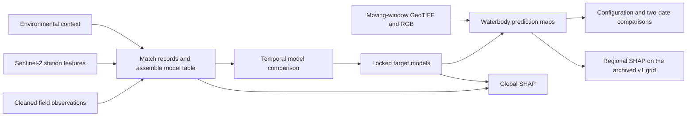

# Sentinel-2 Water Quality Assessment

Waterbody-scale estimation of turbidity, suspended solids, and an indirect dissolved oxygen proxy (DO proxy) in southern Thailand. The study compares models using Sentinel-2 features alone with models that also use environmental context, then examines how context affects predictions and their spatial patterns.

[Research workflow](#research-workflow) · [Selected results](#selected-results) · [Figure gallery](docs/figures.md) · [Reproducibility](#reproducibility)

*Representative maps for Thale Luang, Lower Lang Suan River, and Pak Phanang River. Columns show the study area, turbidity, suspended solids, and DO proxy. Predictions are shown for eligible water pixels in each scene.*

## Research workflow

The model table combines field observations with Sentinel-2 water-pixel features and contextual variables such as antecedent rainfall, wind, and surrounding land cover. The selected models are then applied to 62-band feature rasters and the predictions are displayed alongside Sentinel-2 RGB imagery. See the [workflow documentation](docs/workflow.md) for the inputs, outputs, and evaluation design.

## Selected results

| Target | Locked model | S2-only R² | S2 + Context R² |
|---|---|---:|---:|
| Turbidity | LinearSVR | 0.8802 | 0.9012 |
| Suspended solids | Two-stage LogisticRegression + LinearSVR | 0.6497 | 0.7455 |
| DO proxy | CatBoost | 0.0086 | 0.7300 |

Adding context produced the largest increase in R² for DO proxy. Each comparison uses 33 observations from 2024–2025. That period also informed configuration selection, so these scores are historical comparisons rather than an independent test of the selected configurations.

The [figure gallery](docs/figures.md) includes the configuration and two-date comparisons, as well as global and regional SHAP results. SHAP describes model attribution rather than causation. The maps support research screening and field follow-up.

## Reproducibility

The [research archive on Google Drive](https://drive.google.com/drive/folders/1dSAw7W5tQnsAc93H0o5T-V7KA1UJgAHS?usp=sharing) contains the cleaned observations, precomputed feature tables and GeoTIFFs, fitted model bundles, original notebooks, and reference outputs. Reproducing results from these files does not require Earth Engine access.

1. Place `Water_Quality_Processed_Handoff_Windows_v2.zip` or a shortcut to it in **My Drive**. Keep the filename unchanged and leave the ZIP intact for Colab.
2. Open [00 Start Here in Colab](https://colab.research.google.com/github/Boonyaratt/sentinel2-water-quality/blob/main/notebooks/00_Start_Here.ipynb) and run all cells to verify the input tables, locked models, and sample spatial outputs.
3. Use the [Colab notebook index](notebooks/README.md) to render Figures 3–5 or find the source notebooks for feature extraction.

[Data inventory](docs/data-inventory.md) · [Team handoff guide (ภาษาไทย)](docs/handoff-th.md) · [Feature extraction and Drive inputs (ภาษาไทย)](docs/drive-features-th.md) · [AI agent guide](AGENTS.md)
