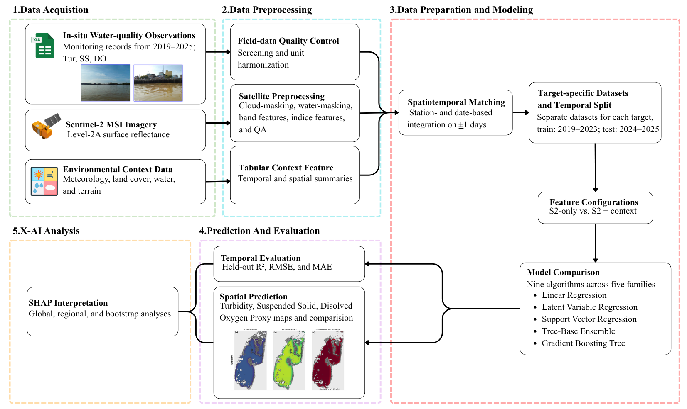
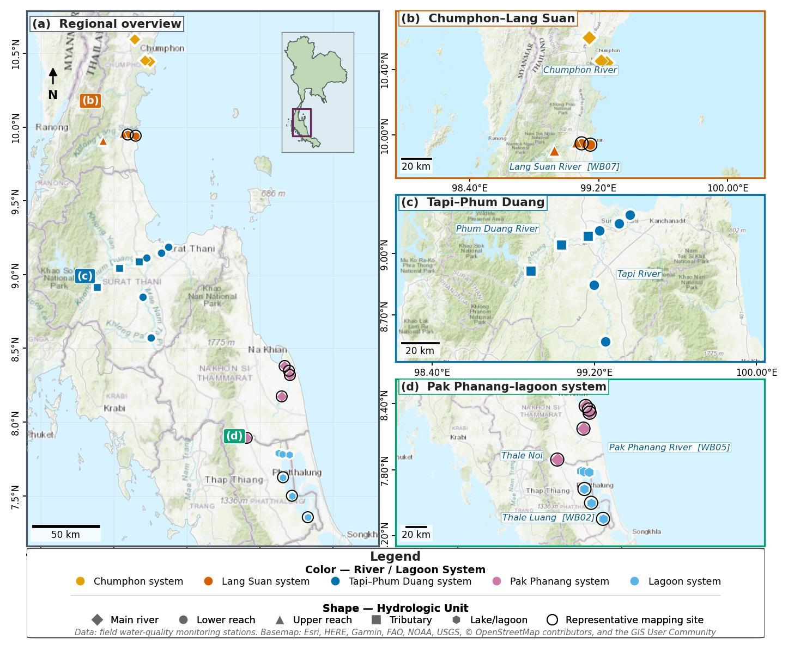
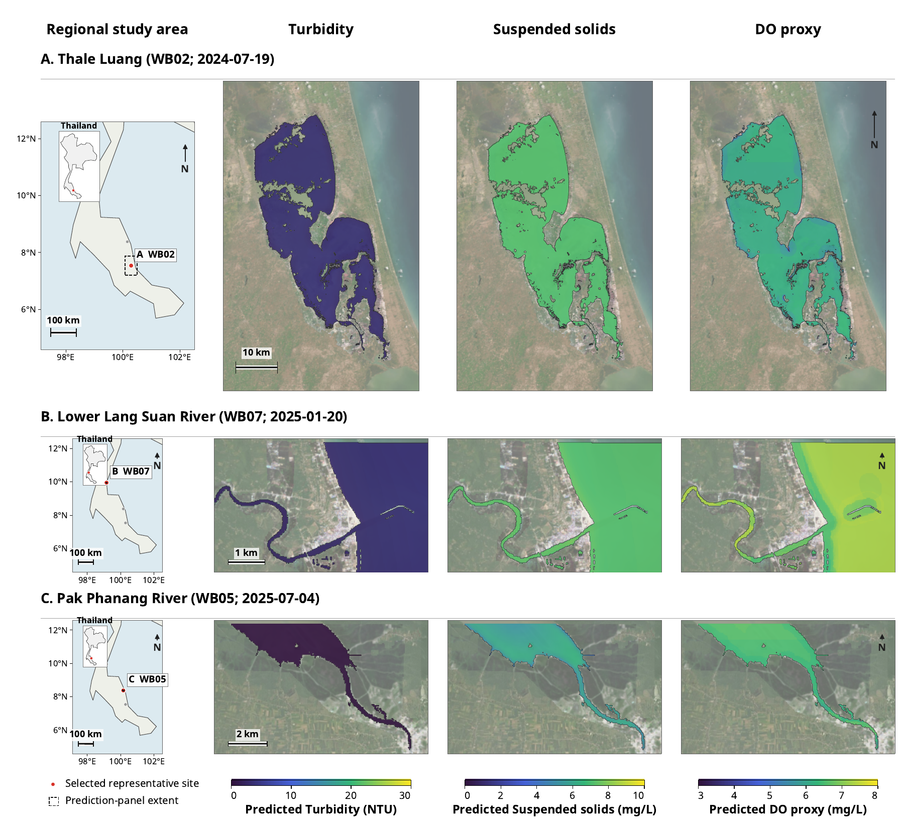
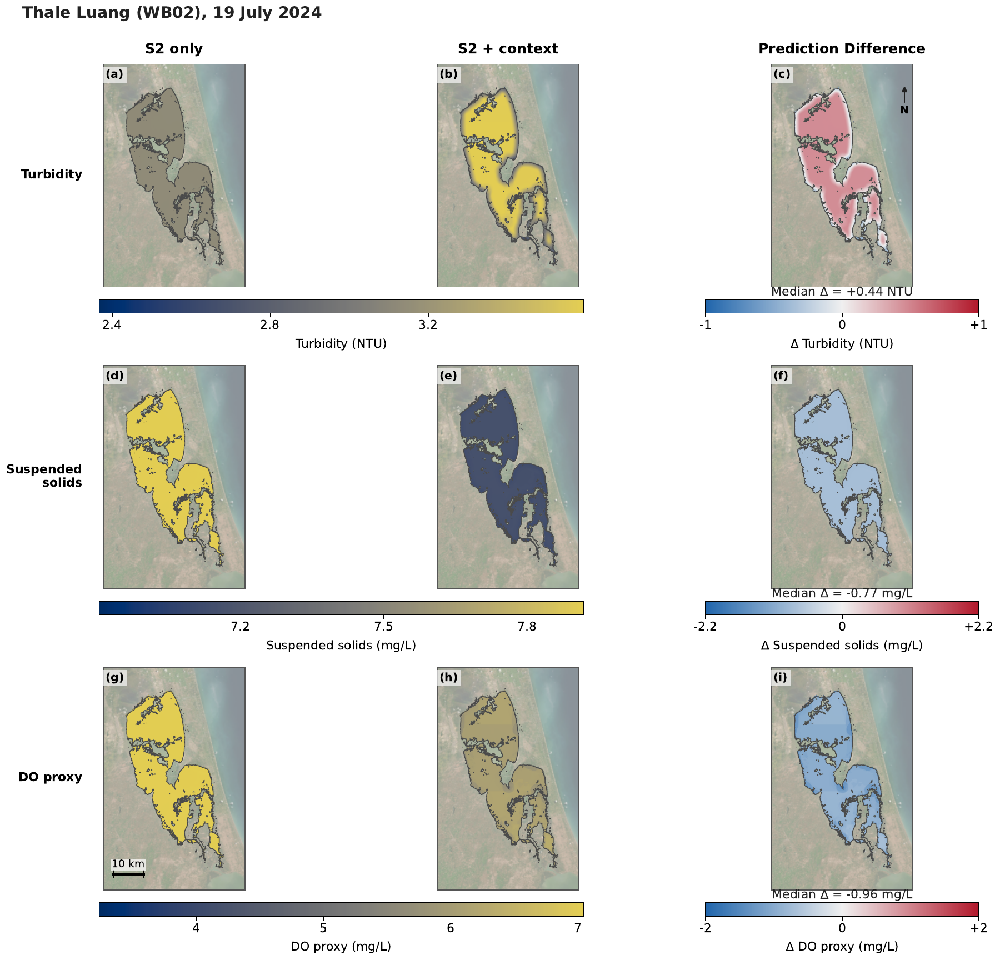
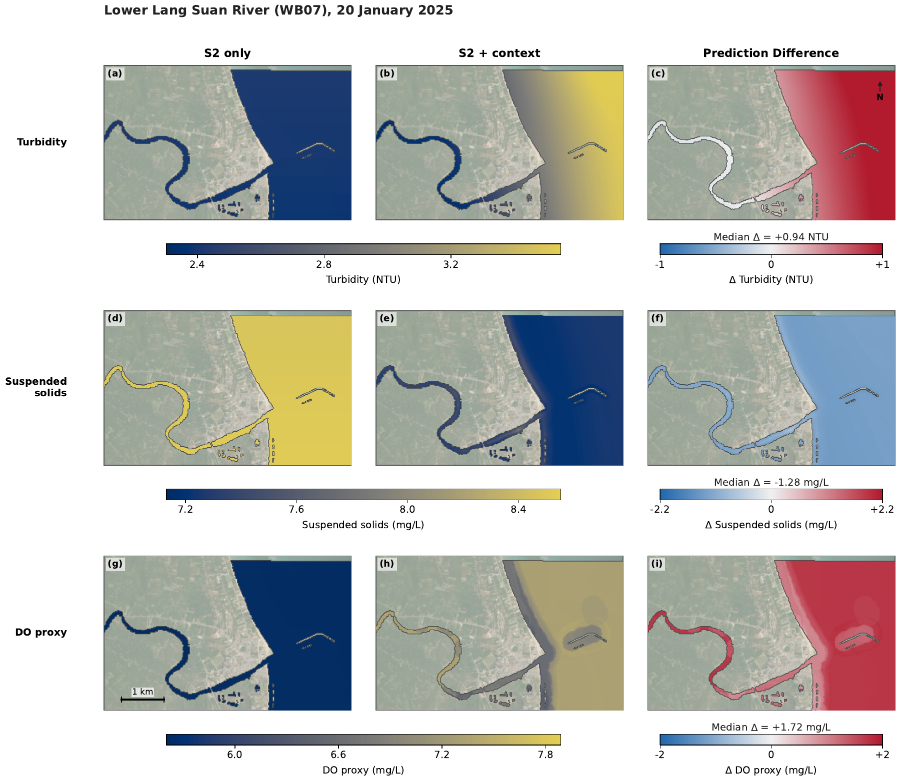
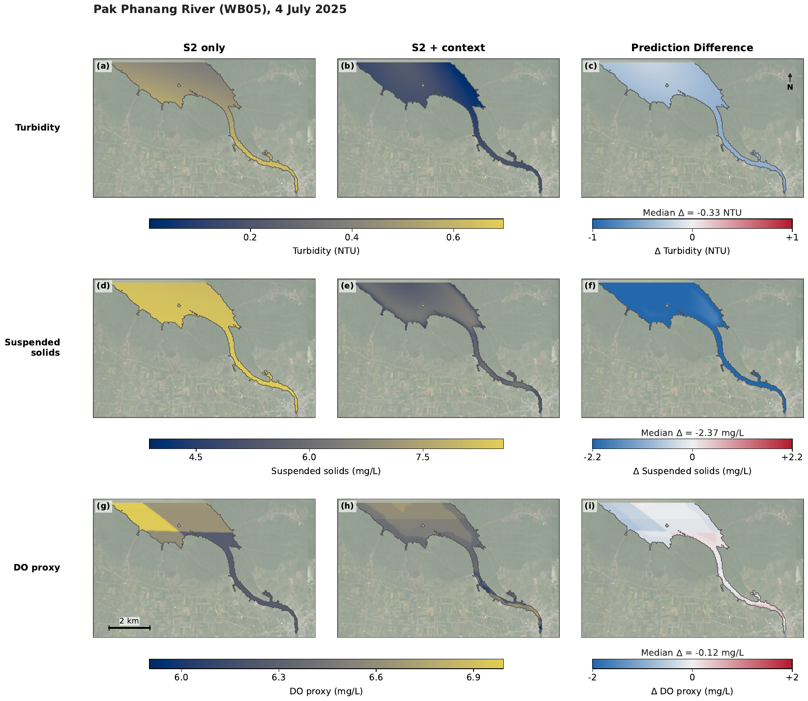
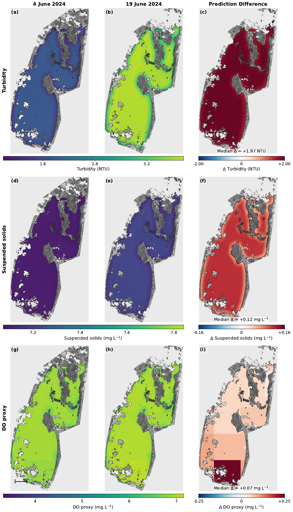
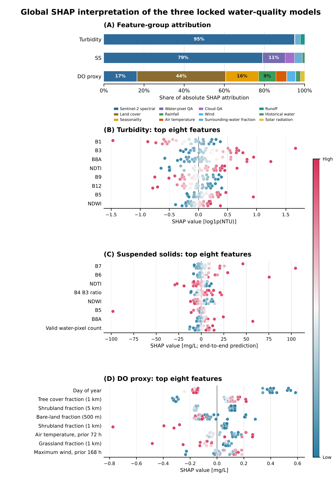
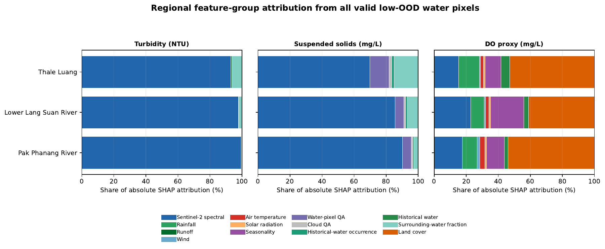

# Figure Gallery

Figure numbers refer to the research manuscript. The file names `figure1` and `figure2` in some notebooks refer to Figs. 4 and 5 here.

## Fig. 1 · Research workflow

## Fig. 2 · Sampling locations

## Fig. 3 · Representative prediction maps

The maps show Thale Luang (WB02, 19 July 2024), Lower Lang Suan River (WB07, 20 January 2025), and Pak Phanang River (WB05, 4 July 2025).

## Fig. 4 · Effect of contextual predictors

Within each site, the prediction difference is **S2 + Context minus S2 only**, displayed on common water pixels under the analysis mask.

## Fig. 5 · Change between two acquisitions

The contrast compares 19 June with 4 June 2024 on the common valid-water mask. The scene-selection record identifies contextual contrast and usable coverage as the selection criteria. The changes in the predicted targets are outcomes of that comparison.

## Fig. 6 · Global SHAP attribution

## Fig. 7 · Regional SHAP attribution

This analysis uses the archived v1 feature and prediction grid. Its regional attribution is not computed from the polygon rasters used for Figs. 3–4.
